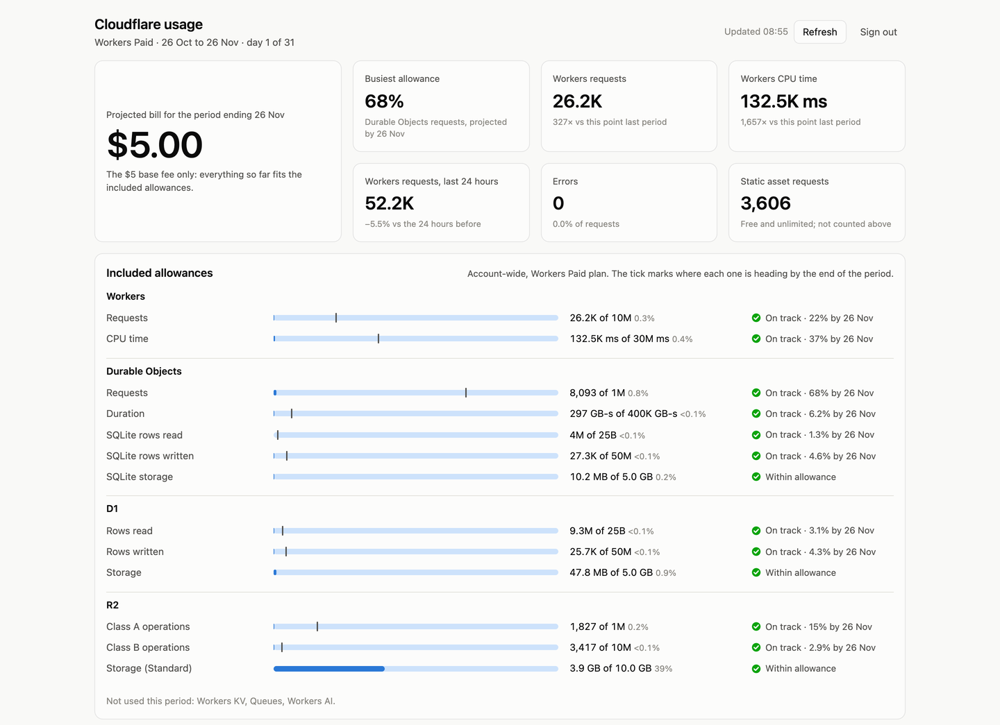
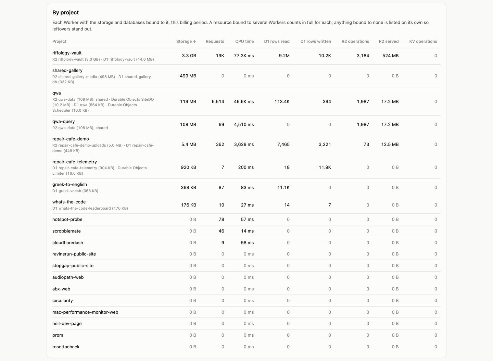
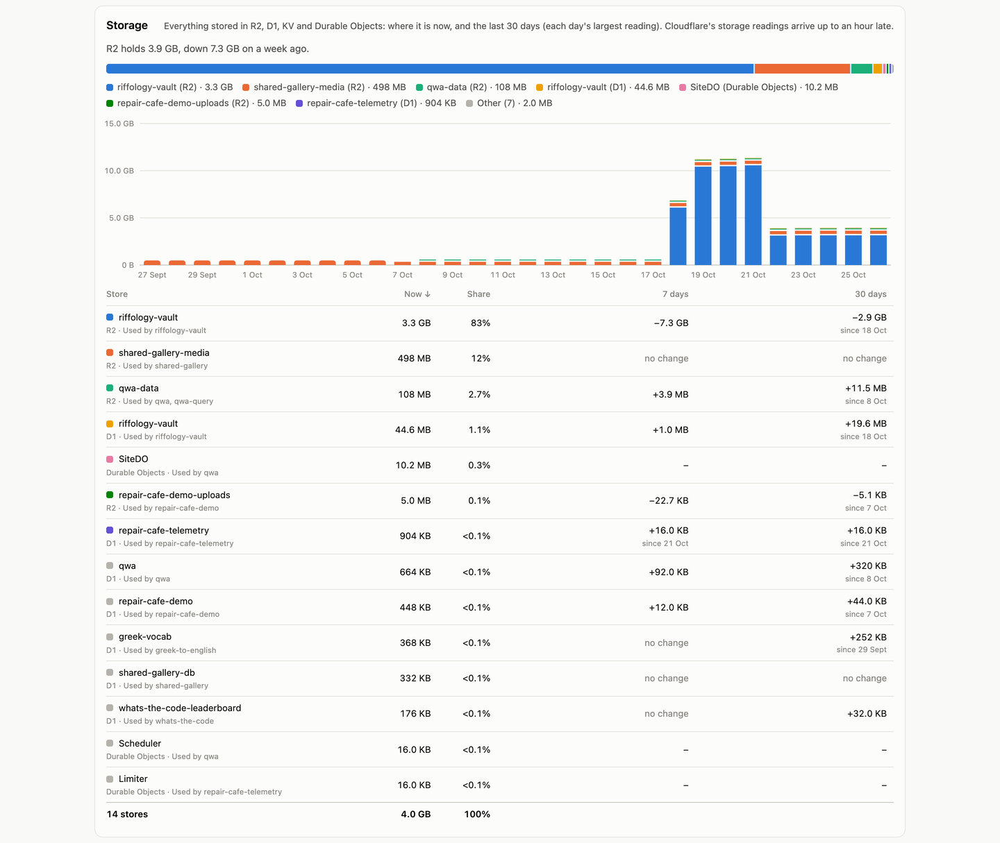
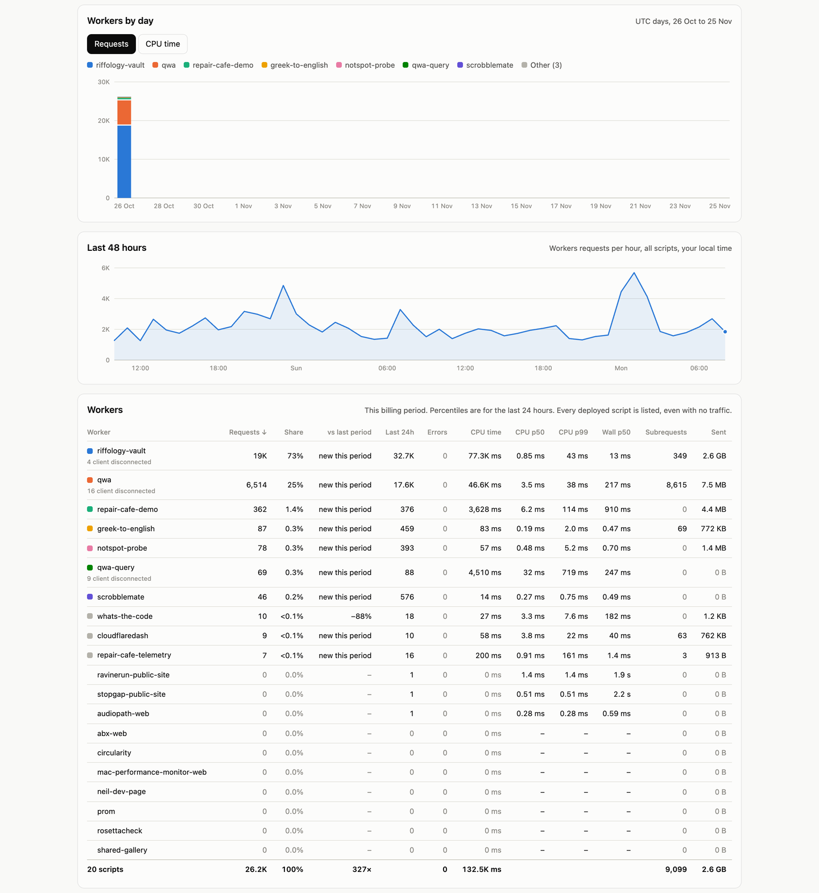

# cloudflaredash

A private dashboard of your Cloudflare account's usage against the
[Workers Paid](https://developers.cloudflare.com/workers/platform/pricing/) plan's included
allowances. It shows where the month is heading, what each project is using, and what the bill
will be if things carry on as they are.

It runs as a single Worker on your own account, behind
[Cloudflare Access](https://developers.cloudflare.com/cloudflare-one/applications/), so only
the people you name can see it.

<picture>
  <source media="(prefers-color-scheme: dark)" srcset="docs/screenshots/overview-dark.png">
  
</picture>

## What it shows

- **Projected bill**: the $5 base fee plus any overage, projected to the end of your billing period.
- **Included allowances**: every metered allowance for Workers, Durable Objects, D1, Workers KV,
  R2, Queues and Workers AI, with how much is used and where it's heading.
- **By project**: each Worker with the storage and databases bound to it, so usage traces back to
  the thing that caused it.
- **Storage**: everything stored in R2, D1, KV and Durable Objects, now and over the last 30 days.
- **Workers**: requests, CPU time, errors and latency per script, by day and hour, against the
  same point in the previous period.
- **Durable Objects, D1, R2, static assets, KV and Queues**: a breakdown of each.

| By project | Storage | Workers |
| --- | --- | --- |
|  |  |  |

Figures come from Cloudflare's GraphQL Analytics API. They are sampled and arrive a few minutes
late, so treat them as close estimates: Cloudflare's invoice is the final word.

## How it works

- The page (`public/`) is static assets, served free without running the Worker.
- The Worker (`src/index.js`) answers one route, `GET /api/usage`. It reads Cloudflare's
  analytics with a **read-only** API token and returns the raw numbers; the browser does the
  arithmetic. Results are cached for 5 minutes, so however many tabs are open, the account sees
  at most one set of analytics queries per cache period.
- **Two locks on the door.** Cloudflare Access signs people in before any request reaches the
  site. The Worker then checks the Access token itself (signature, audience, issuer, expiry) and
  checks the address against its own `ALLOWED_EMAILS` list. A request that somehow skips Access,
  or a too-broad Access policy, still gets nothing. With no list configured, nobody gets in.
- Until it's fully configured, the Worker refuses to serve data and says which settings are missing.

## Setup

You need:

- A Cloudflare account on the **Workers Paid** plan (the dashboard measures that plan's allowances).
- **Zero Trust** turned on for the account. It's free for up to 50 users: open **Zero Trust** in
  the Cloudflare dashboard once and choose a team name and the Free plan.
- Node.js 22 or later.

### 1. Install

```sh
git clone https://github.com/Zesty0wl/cloudflaredash.git
cd cloudflaredash
npm install
npx wrangler login
cp wrangler.example.jsonc wrangler.jsonc
```

In `wrangler.jsonc`, set:

- `account_id` and `vars.ACCOUNT_ID`: your account ID (Account home, then the **⋯** menu by
  the account name, then **Copy account ID**).
- `vars.BILLING_ANCHOR_DAY`: the day of the month your Workers Paid subscription renews
  (**Manage account > Billing > Subscriptions**). This lines the dashboard up with your invoices.

Leave the `ACCESS_` values alone; step 4 fills them in.

`wrangler.jsonc` is in `.gitignore`, so your own settings stay out of the repository.

### 2. Deploy

```sh
npm run deploy
```

This publishes the Worker at `https://cloudflaredash.<your-subdomain>.workers.dev`. Until Access
is set up in step 4, the page loads but shows no data.

### 3. Give it a read-only API token

Create an **account API token** (**Manage account > Account API tokens > Create token >
Custom token**) with these permissions, all **Read**:

| Permission | Used for |
| --- | --- |
| Account Analytics | All the usage figures (GraphQL Analytics API) |
| Workers Scripts | Script names, and which storage each Worker is bound to |
| D1 | Database names |
| Workers KV Storage | Namespace names |
| Queues | Queue names |

Then store it as a secret:

```sh
npx wrangler secret put CF_API_TOKEN
```

### 4. Put it behind Cloudflare Access

**With the setup script.** This needs a second API token, kept on your machine and never given to the Worker,
with **Access: Apps and Policies: Edit**,
**Access: Organizations, Identity Providers, and Groups: Edit** and **Workers Scripts: Edit**:

```sh
export CLOUDFLARE_API_TOKEN=...   # the admin token, not the read-only one
npm run setup-access -- you@example.com
npm run deploy
```

The script:

1. creates an Access application that covers every URL of the Worker: workers.dev, previews and
   any custom domain;
2. lets the addresses you give sign in, turning on sign-in with a one-time code by email if the
   account has no other way set up;
3. writes your team domain and the application's AUD tag into `wrangler.jsonc`;
4. sets the Worker's `ALLOWED_EMAILS` secret to match.

**Or in the dashboard:**

1. **Workers & Pages >** your Worker **> Access > Protect this Worker behind Access**, choose
   **All traffic**, and add a policy that allows your email address.
2. In **Zero Trust > Access > Applications**, open the new application and copy its
   **Application Audience (AUD) Tag** into `vars.ACCESS_AUD`. Set `vars.ACCESS_TEAM_DOMAIN` to
   `<team name>.cloudflareaccess.com`, using the team name you chose for Zero Trust (shown under
   **Zero Trust > Settings**).
3. Tell the Worker who's allowed, using the same addresses as the policy:
   `npx wrangler secret put ALLOWED_EMAILS` (comma-separated; `@example.com` allows a whole domain).
4. `npm run deploy`.

Open the workers.dev URL, sign in, and the dashboard loads.

## Managing who has access

Access is decided in two places, the Access policy and the Worker's `ALLOWED_EMAILS` secret,
and someone has to be in both to see anything. `npm run admins` keeps them in step, treating the Access
policy as the source of truth. It uses the same admin `CLOUDFLARE_API_TOKEN` as step 4.

```sh
npm run admins                                   # who has access
npm run admins -- add colleague@example.com      # let someone in
npm run admins -- add @example.com               # everyone with an address at a domain
npm run admins -- remove colleague@example.com   # take someone out
npm run admins -- sync                           # copy the policy to the Worker again
```

Changes take effect straight away; no deploy is needed. If you edit the Access policy in the
dashboard instead, run `npm run admins -- sync` afterwards. Without the script, update the policy
and run `npx wrangler secret put ALLOWED_EMAILS` with the full list.

The Worker only mirrors email and email-domain rules. If your policy also lets people in another
way (an identity provider group, say), `sync` warns you; those people will be refused by the Worker
until you add their addresses.

## Using your own domain (optional)

The workers.dev URL works fine on its own. To use a domain on your Cloudflare account as well,
uncomment `routes` in `wrangler.jsonc`, set the hostname, and `npm run deploy`. Worker-level
Access covers custom domains too, so there's nothing else to set up. To serve the dashboard only on your domain,
also set `"workers_dev": false`.

If you'd rather protect the hostname with a self-hosted Access application instead, that works
too. Put that application's AUD tag in `vars.ACCESS_AUD`, and `npm run admins` manages its policy.

## Local development

```sh
cp .dev.vars.example .dev.vars   # then paste a read-only token into CF_API_TOKEN
npm run dev
```

`npm run dev` serves the dashboard at `http://localhost:8787` with your account's real data.
There's no Access in front of `wrangler dev`, so `.dev.vars` sets `DEV_SKIP_ACCESS=true`, which the
Worker honours only for requests to `localhost` and `127.0.0.1`. `.dev.vars` is never deployed.

```sh
npm test
```

runs the tests for the Access token check, the allow-list, billing periods and the admin script.

## Keeping prices current

Allowances and overage prices live in [`public/pricing.js`](public/pricing.js), with the date they
were last checked against Cloudflare's pricing pages. When Cloudflare changes its prices, update
that file and `PRICES_CHECKED`. Workers Logs, Images, Stream and other separately billed products
aren't included.

## What it costs to run

Very little. The page is static assets, which are free. The Worker runs about once per page load
and refresh, and the analytics queries are cached for 5 minutes. Its own usage appears on the
dashboard alongside everything else.

## Licence

[MIT](LICENSE)
